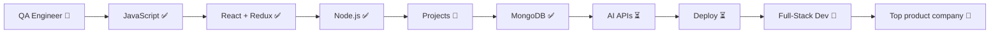

<!-- Replace maskman0710 everywhere below with your GitHub username -->

<div align="center">


[](https://git.io/typing-svg)

</div>

---

## 🐞 The Origin Story (a bug report)

```diff
Title:     Developer who only tested software, never built it
Reporter:  Rishi (QA, ~1.5 yrs)
Severity:  Career-defining
Status:    🔄 IN PROGRESS — fix shipping, one commit at a time

- Expected behaviour : keep finding other people's bugs forever
+ Actual behaviour   : learning to build the product end to end
+ Root cause         : curiosity about what happens on the other side of the bug report
```

> Most devs learn to code first and testing later (or never).
> I did it the other way round. I already think in **edge cases, failure modes and "what if the user does THIS?"** before I write line one.

---

## ⚔️ My unfair advantage

| What QA taught me | How it shows up in my code |
|---|---|
| 🔍 Think in edge cases | I handle empty states, bad input and failed requests, not just the happy path |
| 💥 Break things on purpose | I try to crash my own app before anyone else does |
| 🧪 Test mindset | I ask "how will this fail?" while designing, not after shipping |
| 🗣️ Write clear reports | My commits, READMEs and docs are written for humans |

---

## 🧰 Tech Stack

<div align="center">


</div>

---

## ✅ Test Run: My Learning Journey

```text
$ npm run journey

 PASS  javascript-fundamentals     DOM · async/await · Fetch · localStorage
 PASS  todo-app-series             10 progressive challenges
 PASS  react-core                  useState · useEffect · useRef · useCallback
 PASS  react-advanced              custom hooks · Context API · React Router
 PASS  redux-toolkit               state management
 PASS  blog-app-capstone           React + Redux + Router + Appwrite auth
 PASS  nodejs                      backend foundations
 RUN   expense-tracker             backend ✔  frontend ⏳
 TODO  mongodb
 TODO  ai-apis
 TODO  deployment
 TODO  portfolio-website

Test Suites: 7 passed, 1 running, 4 pending
Status:      shipping 🚀
```

---

## 🚀 Featured Projects

🚀 Featured Projects
<table> <tr> <td width="50%" valign="top">
🏢 Samsun Consultancy

**Full Stack Project for a Consultancy** with, post management and form management.

`html` `javascript` `css` `PHP`

[🔗 Repo](#) · [🌐 Live demo](https://samsunconsultancy.netlify.app/)

</td> <td width="50%" valign="top">
📝 Blog App

**Full React capstone** with auth, post management and routing.

`React` `Redux Toolkit` `React Router` `Appwrite`

[🔗 Repo](https://github.com/maskman0710/Blog-Post-Application) · [🌐 Live demo](#)

</td> </tr> <tr> <td width="50%" valign="top">
💸 Expense Tracker 🚧

Track where your money goes. **Backend done, frontend in progress.**

`Node.js` `+ React`

[🔗 Repo](https://github.com/maskman0710/Nodejs-series/tree/main/fullstack_expensetracker) · [🌐 Live demo](#)


</td> <td width="50%" valign="top">
✅ Todo App Series
  
10 progressive builds: DOM, async/await, Fetch API, error handling, localStorage.

`Vanilla JavaScript`

[🔗 Repo](https://github.com/maskman0710/React_learning_projects/tree/main/ToDo)

</td> </tr> <tr> <td colspan="2" valign="top">
🌐 Portfolio (coming soon)


My personal site, built in React.


`React`

</td> </tr> </table>

---

## 🐛 Known Issues (being fixed in public)

I don't hide my bugs, I track them.

```yaml
open_issues:
  - id: JS-001
    title: "Hoisting: var vs let behaviour"
    status: fixing
  - id: JS-002
    title: "Recursion tracing"
    status: fixing
  - id: JS-003
    title: "Reference vs value types"
    status: fixing
resolved: "Closing issues faster than I open new ones 😉"
```

---

## 🧠 DSA Practice

Grinding **Data Structures & Algorithms in JavaScript** using *Striver's A2Z* and *Love Babbar's 450* sheets, starting with Arrays and Strings and working up.

---

## 🎯 Roadmap



**How I learn:** project-first. Learn a concept, build something with it, ship it, repeat.

---

## 📊 GitHub Stats

<div align="center">


</div>

---

## 🤝 Let's Connect

<div align="center">

[](https://x.com/RishiGoyal0710)
[](https://www.linkedin.com/in/rishi-goyal-960641208/?isSelfProfile=true)
[](mailto:rishigprofessional@gmail.com)

**I post my journey on GitHub and Twitter/X. Follow along, I ship in public.**

*"Found bugs for a living. Now I'm writing code worth testing."* 🧪


</div>
